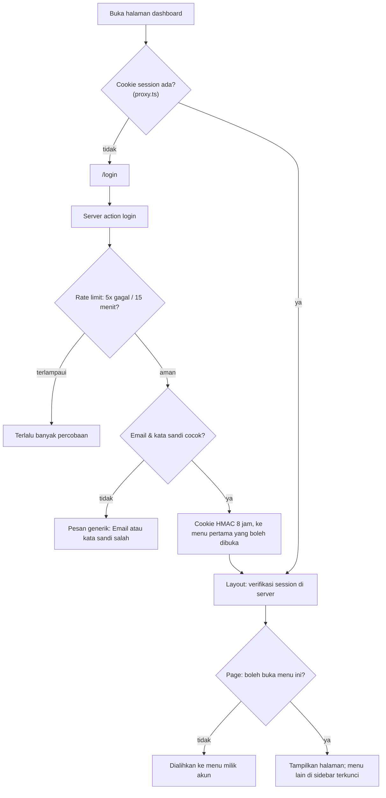
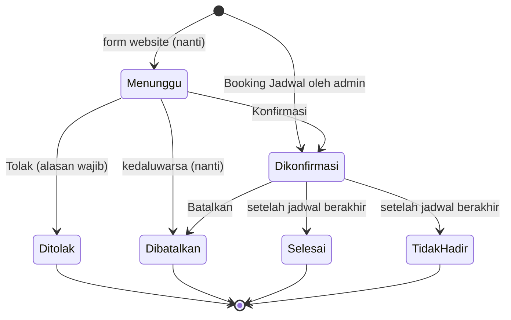
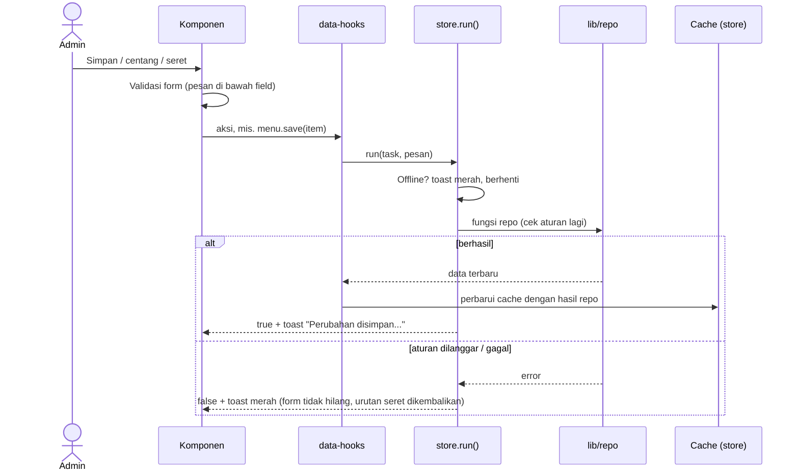
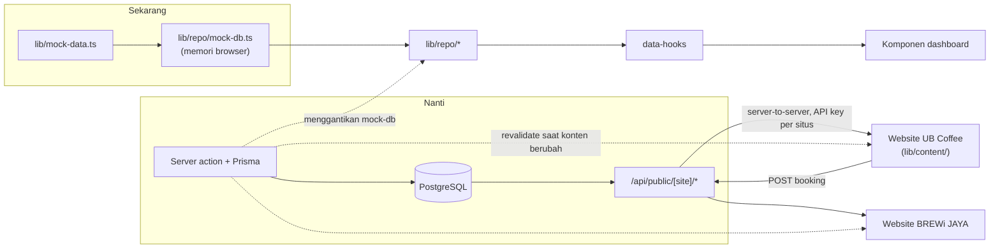

# Arsitektur Dashboard Admin UB Coffee & BREWi JAYA

Dokumen ini menjelaskan susunan kode dashboard, alur datanya, dan apa saja yang perlu disiapkan saat
dashboard dipasang database dan disambungkan ke website UB Coffee dan BREWi JAYA. Dashboard adalah
**sumber kebenaran bentuk data**: website menyesuaikan diri lewat lapisan datanya masing-masing.

## 1. Project Overview

### Latar belakang

Isi kedua website (menu, berita, outlet, foto) awalnya ditulis langsung di kode, sehingga setiap
perubahan harus lewat developer dan redeploy. Dashboard ini memindahkan pengelolaan konten ke admin dan
menambahkan pengelolaan booking meeting room UB Coffee. Acuan awalnya
[spesifikasi-dashboard-ub-coffee-brewi-jaya.md](../spesifikasi-dashboard-ub-coffee-brewi-jaya.md);
perbedaan kode dengan spesifikasi dicatat di [PERBEDAAN-SPESIFIKASI.md](PERBEDAAN-SPESIFIKASI.md).

Seluruh tampilan sudah jadi, tetapi data masih contoh di memori browser. Kode sudah dirapikan agar
pemasangan database cukup dengan mengganti isi lapisan `lib/repo/`, tanpa mengubah komponen.

### Fitur

| Menu | Isi |
| --- | --- |
| Meeting Room (`/meeting-room`) | Statistik, jadwal harian 3 tempat (Arjuna, Semeru, Open Space), filter, daftar booking, Konfirmasi / Tolak / Batalkan / Tandai Selesai / Tidak Hadir, Booking Jadwal oleh admin, pesan WhatsApp siap kirim |
| Konten Website UB Coffee (`/publikasi/ub-coffee`) | Tab Publikasi (Berita & Artikel dengan tag) dan tab Landing Page: Foto Hero, Menu, Reservasi, Lokasi & Jam Buka, Tentang & Kontak |
| Publikasi BREWi JAYA (`/publikasi/brewi-jaya`) | Publikasi (Berita & Artikel dengan tag) |

Akses: Super Admin membuka semua menu; Admin UB Coffee membuka Meeting Room dan Konten Website UB Coffee;
Admin BREWi JAYA membuka Publikasi BREWi JAYA. Menu di luar hak akses tampil terkunci dan ditolak di server.

### Tech stack

- Next.js 16 (App Router, Turbopack) dengan React 19 dan TypeScript
- Tailwind CSS v4
- ESLint
- Tanpa library tambahan; refactor persiapan database tidak menambah library

## 2. Project Structure

```
DASHBOARD/
├── app/
│   ├── layout.tsx                 Kerangka HTML, font, metadata
│   ├── page.tsx                   Arahkan ke menu pertama yang boleh dibuka (atau /login)
│   ├── (auth)/login/              Halaman login, LoginForm, server action login/logout
│   └── (dashboard)/
│       ├── layout.tsx             Cek session, DashboardProvider, Shell
│       ├── meeting-room/page.tsx  Menu 1 (cek akses Meeting Room di server)
│       └── publikasi/[site]/      Menu 2 & 3 (cek akses per situs di server)
├── components/
│   ├── Shell.tsx, Sidebar.tsx, TopBar.tsx   Kerangka halaman
│   ├── ui.tsx, Dialog.tsx, Icon.tsx         Komponen dasar (Button, Field, StatCard, FormDialog, ...)
│   ├── ImageUploader.tsx, PhotoView.tsx     Unggah dan tampilkan foto
│   ├── SortableGrid.tsx                     Grid seret-untuk-urutkan
│   ├── store.tsx                  Cache data, run(), toast, peringatan belum disimpan
│   ├── data-hooks.tsx             Hook per entitas: satu-satunya jalan komponen mengubah data
│   ├── meeting/
│   │   ├── MeetingRoomView.tsx, DayCalendar.tsx, BookingRow.tsx
│   │   └── dialogs/               BookingSummary, Confirm, Reason, Detail, ManualBooking
│   └── publikasi/
│       ├── PublikasiView.tsx      Tab Publikasi / Landing Page
│       ├── PostsSection.tsx       Daftar publikasi
│       ├── posts/                 PostEditor, TagPicker, SeoPanel
│       ├── ReservasiSection.tsx
│       ├── reservasi/             InfoForm, PhotosBlock, PackagesBlock, SubHeading
│       └── HeroSection, MenuSection, OutletsSection, AboutSection, GallerySection, MarkdownEditor
├── lib/
│   ├── types.ts                   Semua tipe entitas (kontrak data)
│   ├── sites.ts                   Konfigurasi dua situs, hak akses, menu sidebar
│   ├── booking.ts                 Ruangan, state machine status, cek bentrok, jeda, template WA
│   ├── posts.ts                   Jenis publikasi, aturan tag, status tayang
│   ├── format.ts                  Tanggal WIB, rupiah, nomor HP, slug, id
│   ├── auth.ts, ratelimit.ts      Auth demo dan rate limit login (sementara)
│   ├── mock-data.ts               Data contoh
│   └── repo/                      Lapisan data async per entitas (sekarang mock, nanti Prisma)
├── proxy.ts                       Redirect ke /login tanpa session, CSP dengan nonce
├── next.config.ts                 Security headers
└── docs/                          Dokumen ini dan catatan perbedaan spesifikasi
```

| Folder | Fungsi |
| --- | --- |
| `app/` | Routing. Halaman hanya mengecek session dan hak akses di server, lalu merender view |
| `components/` | Tampilan. Membaca dan mengubah data hanya lewat `data-hooks.tsx` |
| `components/store.tsx` | Cache data di browser, `run()` (cek koneksi + toast), peringatan perubahan belum disimpan |
| `lib/` (selain `repo/`) | Tipe dan fungsi murni: aturan booking, aturan publikasi, format, konfigurasi situs |
| `lib/repo/` | Lapisan data: fungsi async yang nanti diganti server action + Prisma |

## 3. OOP Implementation

Project ini **tidak mendefinisikan class sendiri**. React modern dan Next.js App Router dibangun dengan
fungsi dan komposisi komponen; satu-satunya class yang dipakai adalah `Error` bawaan JavaScript, yang
dilempar repo saat aturan dilanggar (misalnya `new Error("SLUG_TAKEN")`). Yang dijelaskan di bawah
adalah prinsip desain yang memang diterapkan, dengan file nyata sebagai contoh.

### Encapsulation

- **`lib/repo/*`** menyembunyikan dari mana data berasal. `usePosts().save()` memanggil
  `createPost()`/`updatePost()` tanpa tahu bahwa isinya sekarang mock di memori (`mock-db.ts`).
- **`lib/booking.ts`** membungkus aturan booking: daftar ruang `ROOMS`, `overCapacity()`,
  state machine `TRANSITIONS`/`canTransition()`, `findConflict()` dengan jeda `BUFFER_MIN` 30 menit, dan
  template WhatsApp `waLink()`.
- **`run()` di `components/store.tsx`** membungkus cek koneksi, pesan gagal, dan toast, sehingga hook
  cukup memanggil repo lalu memperbarui cache.

### Abstraction

- **`lib/types.ts`** adalah kontrak data. Komponen hanya mengenal bentuk `Booking`, `Post`, `PostTag`,
  `MenuItem`, dan seterusnya, bukan asal datanya.
- **Hook di `components/data-hooks.tsx`** (`useBookings`, `usePosts`, `useMenu`, ...) adalah antarmuka
  komponen ke data. Setiap aksi mengembalikan `Promise<boolean>`: berhasil atau gagal.

### Composition

- `Shell` merangkai `Sidebar` dan `TopBar`.
- `PublikasiView` merangkai section sesuai `SiteConfig.sections`.
- `ReservasiSection` merangkai `InfoForm`, `PhotosBlock`, dan `PackagesBlock`.
- `PostEditor` merangkai `TagPicker`, `SeoPanel`, dan `MarkdownEditor`.

### Pemilihan berdasarkan tipe

Mirip polymorphism, tetapi dalam gaya fungsional: peta `render: Record<LandingKey, () => ReactNode>` di
`PublikasiView.tsx` memilih editor bagian Landing Page, dan `TRANSITIONS: Record<BookingStatus, ...>` di
`lib/booking.ts` menentukan transisi yang sah per status. TypeScript memastikan semua key tertangani.

## 4. Data Flow & Business Flow

### Login dan hak akses



`proxy.ts` hanya melakukan cek cepat (ada cookie atau tidak). Verifikasi tanda tangan session dan hak akses
dilakukan di server pada layout dan page; menyembunyikan menu bukan otorisasi.

### Alur status booking



Transisi lain ditolak dua kali: di klien (`useBookings`) untuk pesan cepat, dan di `lib/repo/bookings.ts`
sebagai pengaman. Setiap perubahan dicatat di riwayat booking. Booking Menunggu dan Dikonfirmasi menempati
slot; cek bentrok per ruang memakai jeda 30 menit sebelum dan sesudah.

### Alur edit konten



### Alur data: dashboard, database, API publik, website



### Aturan data

1. Komponen membaca dan mengubah data hanya lewat hook di `components/data-hooks.tsx`.
2. `setSiteCache` dan `setBookingsCache` di `store.tsx` hanya dipakai oleh `data-hooks.tsx`.
3. `lib/repo` hanya diimpor oleh `data-hooks.tsx` dan `store.tsx`; hanya `lib/repo/mock-db.ts` yang
   membaca `lib/mock-data.ts`.
4. `lib/repo` bebas API browser dan hanya menerima serta mengembalikan data biasa yang serializable,
   supaya nanti bisa langsung menjadi server action.
5. Pemeriksaan penting dilakukan dua kali: di klien untuk pesan cepat, dan di repo sebagai pengaman
   (transisi status booking, slug post kembar, tag post, tag baru).

## 5. Integration Readiness

### 5.1 Model data

| Entitas | Tipe (`lib/types.ts`) | Fungsi repo (`lib/repo/`) | Catatan untuk Prisma |
| --- | --- | --- | --- |
| Situs | `SiteConfig` (`lib/sites.ts`) | – | Konfigurasi di kode; model `Site` cukup slug, nama, URL, API key |
| Booking | `Booking`, `BookingHistory` | `listBookings`, `confirmBooking`, `rejectBooking`, `cancelBooking`, `markBooking`, `createManualBooking` | `history` menjadi tabel sendiri (atau `AuditLog`). Waktu disimpan UTC, ditampilkan WIB. Exclusion constraint anti-bentrok + jeda |
| Ruangan | `Room`, `RoomId` | – (`ROOMS` di `lib/booking.ts`) | Menjadi tabel `MeetingRoom` (id `arjuna`, `semeru`, `open-space`; `capacity` boleh kosong) |
| Input booking admin | `ManualBookingInput` | `createManualBooking` | – |
| Publikasi | `Post`, `PostSeo` | `createPost`, `updatePost`, `removePost` | Slug unik per situs. `body` Markdown, dirender dan disanitasi di website |
| Tag publikasi | `PostTag` | `createPostTag` | Tabel `PostTag` (slug unik per situs) + tabel penghubung post–tag. Post menyimpan id tag |
| Menu | `MenuItem` | `createMenuItem`, `updateMenuItem`, `setMenuAvailable`, `removeMenuItem`, `reorderMenu` | Harga `Int` rupiah. Kategori tetap (union) |
| Foto | `Photo` | – | Menjadi `Media`. `hue` dan `src: null` hanya untuk placeholder mock |
| Foto hero | `Photo[]` | `addHeroPhotos`, `reorderHero`, `removeHeroPhoto` | Tabel `HeroSlide` |
| Galeri | `GalleryItem` | `addGalleryPhotos`, `updateGalleryItem`, `removeGalleryItem`, `reorderGallery` | Data ada, tetapi belum ditampilkan di dashboard |
| Outlet & jam buka | `Outlet`, `DayHours` | `createOutlet`, `updateOutlet`, `removeOutlet` | Jam buka sekarang array 7 hari dengan index 0 = Senin; spesifikasi dan landing page memakai 0 = Minggu. Simpan sebagai `OutletHours(dayOfWeek)` dengan satu konvensi |
| Tentang & kontak | `SiteSettings` | `updateSettings` | Key-value tervalidasi (`SiteSetting`) |
| Info reservasi | `MeetingRoomInfo`, `RentalPrice`, `MeetingPackage` | `updateMeetingRoomInfo`, `addRoomPhotos`, `reorderRoomPhotos`, `removeRoomPhoto`, `createMeetingPackage`, `updateMeetingPackage`, `removeMeetingPackage` | Bentuk per ruang: keputusan terbuka (5.5) |

Berlaku untuk semua tabel konten:

- Tambahkan `siteId` (sekarang tersirat dari kunci situs), `sortOrder` (sekarang urutan array), serta
  `createdAt`/`updatedAt`. Field ini sengaja belum ditambahkan ke tipe agar perilaku tidak berubah.
- **id item baru nanti dibuat server.** Sekarang id item baru masih dibuat di dialog (`uid()` di Menu,
  Post, Outlet, Paket, dan foto di `ImageUploader`); repo membedakan create dan update dari ada/tidaknya id.
- Urutan dikirim ke repo sebagai daftar id (`reorderHero(site, ids)` dan sejenisnya), siap menjadi update
  `sortOrder`.

### 5.2 Endpoint

Endpoint di bawah dipanggil **dari server website** dengan API key per situs (spesifikasi bagian 8).
Kolom "usulan landing page" diambil dari dokumen arsitektur landing page UB Coffee; rencana dashboard yang
berlaku, dan landing page yang menyesuaikan.

| Data | Rencana dashboard `/api/public/[site]` | Usulan landing page UB Coffee | Catatan |
| --- | --- | --- | --- |
| Info situs | `GET /settings` | `GET /api/site` | |
| Foto hero | `GET /hero` | `GET /api/hero-photos` | |
| Menu | `GET /menu` | `GET /api/menu` | Hanya item Tersedia, urut |
| Publikasi | `GET /posts?type=&tag=&limit=` | `GET /api/news` | Hanya post Tayang. Tag dikirim sebagai slug |
| Tag publikasi | `GET /tags` (baru) | `GET /api/news-categories` | Belum ada di spesifikasi; perlu ditambahkan |
| Lokasi & jam buka | `GET /outlets` | `GET /api/locations` | Jam buka dikelompokkan untuk website |
| Ruangan | `GET /meeting-room/rooms` (baru) | `GET /api/rooms`, `?bookable=true` | Belum ada di spesifikasi |
| Info reservasi (harga, paket, teks) | `GET /meeting-room/info` (baru) | `/api/room-prices`, `/api/meeting-packages`, `/api/reservation-text` | Satu endpoint cukup |
| Jadwal terisi | `GET /meeting-room/availability?date=` | `GET /api/bookings?from=&to=` | Selalu data segar, tanpa cache |
| Kirim booking | `POST /meeting-room/bookings` | `POST /api/reservations` | Validasi ulang + cek bentrok di server |
| Galeri | `GET /gallery` | – | Hanya situs yang punya galeri |

### 5.3 Pemetaan dashboard ↔ landing page UB Coffee

Kondisi setelah refactor dashboard. "Arah" menyebut siapa yang menyesuaikan.

| Entitas | Sudah sama | Beda nama / bentuk | Hanya di satu sisi | Arah |
| --- | --- | --- | --- | --- |
| Ruangan | id `arjuna` / `semeru` / `open-space`, nama "Arjuna Meeting Room", "Semeru Meeting Room", "Open Space", kapasitas 15 / 15 / tanpa batas | Dashboard `Room` + `kind`; landing `BookableRoom` / `Room` | Landing: `desc`, `suitable`, `facilities`, `photos` per ruang | Info per ruang: keputusan terbuka |
| Info reservasi | Harga sewa (Internal UB, Eksternal), paket, catatan paket | Harga `number` vs `"IDR 100K"`; paket `minPax` / `extraPerPax` vs `price` / `extra` (string) | Dashboard: `snackInfo`, `orderingNote`, deskripsi paket, satu set foto dan fasilitas. Landing: `intro`, `rentNote`, `cta` | API memformat harga. Bentuk per ruang: keputusan terbuka |
| Tag berita | `id`, `slug`, `label`; slug `event`, `kolaborasi`, `tips`, `cerita` (id `cat-…` sama) | `PostTag` vs `NewsCategory`; `Post.tags` berisi id vs `NewsItem.categories` berisi slug | Dashboard: `type` pada tag; tag `promo` dan `info` | Landing mengganti `categories` menjadi `tags` dan menambah `type` pada kategori. API mengirim slug |
| Publikasi | Judul, ringkasan, tanggal, jenis Berita / Artikel, beberapa tag per post | `BERITA` vs `berita`; `publishedAt` vs `date`; `body` Markdown vs `string[]` paragraf; `cover` boleh kosong vs `image` wajib | Dashboard: `slug`, `status`, `seo` | Detail tetap dibuka di panel landing page. API hanya mengirim post Tayang |
| Booking | `roomId`, `date`, `start`, `end` | `pax` / `organization` / `note` vs `people` / `org` / `notes` | Dashboard: `purpose` (wajib), `status`, `history`, `source`. Landing payload: `package`, `priceCategory` | Ikut dashboard: kode `MR-…`, kelipatan 30 menit, jeda 30 menit, `purpose` wajib |
| Jam buka / lokasi | Nama, alamat, patokan | Per hari (0 = Senin) vs baris berkelompok (`days`, 0 = Minggu) | Dashboard: WhatsApp per outlet, `isActive`. Landing: `addressShort`, `mapsEmbed`, `directionsUrl` | API mengelompokkan jam dan menyusun URL peta. Outlet utama: keputusan terbuka |
| Menu | id, nama, kategori (Kopi / Non-Kopi / Makanan), deskripsi, harga opsional | `photo` (boleh kosong) vs `image` | Dashboard: `isAvailable`, `isFeatured`, `tags` | API hanya mengirim item Tersedia, sesuai urutan |
| Foto hero | id, alt, urutan | `Photo` vs `HeroPhoto` | Dashboard: `hue` (mock) | Rasio ikut dashboard: 16:9, lebar minimal 1920 px |
| Tentang & kontak | Link PDF menu | `about` vs `tagline`; Instagram `@user` vs teks tampilan + URL | Landing: `name`, `company`, `companyUrl`, `whatsapp`, `whatsappDisplay`, `mainLocationId` | API menyusun URL Instagram. Field yang hanya di landing: keputusan terbuka |

### 5.4 Keputusan yang sudah diambil

| # | Keputusan | Alasan |
| --- | --- | --- |
| 1 | Ruangan **Arjuna Meeting Room** (`arjuna`) dan **Semeru Meeting Room** (`semeru`), 15 orang, plus **Open Space** (`open-space`) | id dan nama sama dengan landing page, jadi data dan form landing langsung cocok |
| 2 | **Open Space tanpa batas kapasitas** (`capacity` opsional) | Sama dengan landing page. Validasi peserta hanya untuk ruang yang punya kapasitas; Open Space tidak menampilkan angka kapasitas |
| 3 | **Jenis Berita dan Artikel + tag untuk kedua situs**: tag sebagai data `{ id, slug, label, type }`, maksimal 3 per post, wajib minimal 1, bisa ditambah dari dropdown (langsung tersimpan), terikat jenis, slug unik per situs | **Permintaan mentor**: satu aturan publikasi untuk UB Coffee dan BREWi JAYA. Menggantikan keputusan sebelumnya (BREWi JAYA memakai Event / Promo / Menu Baru tanpa tag) |
| 4 | Data menyimpan **id tag**; API mengirim **slug** | id stabil untuk relasi di database; slug untuk filter di website |
| 5 | **Aturan booking ikut dashboard**: kode `MR-…`, kelipatan 30 menit, jeda bersih-bersih 30 menit, keperluan (`purpose`) wajib | Dashboard adalah sumber kebenaran, dan cek bentrok dijamin di server. Form landing page yang menyesuaikan |
| 6 | Rasio foto hero **16:9** | Mengikuti panduan dashboard |
| 7 | Detail berita **tetap dibuka di panel landing page**, tanpa route `/news/<slug>` | Sesuai perilaku landing page sekarang |
| 8 | **Dashboard menjadi sumber kebenaran bentuk data**; website menyesuaikan lewat lapisan datanya (`lib/content/` di UB Coffee) | Satu tempat untuk aturan dan validasi |
| 9 | Flag `hasPostTags` dan `postTypes` dihapus, diganti konstanta `POST_TYPES` di `lib/posts.ts` | Aturannya sama di semua situs. Kalau nanti ada situs dengan aturan publikasi berbeda, flag per situs bisa ditambahkan lagi |
| 10 | `createdAt`, `updatedAt`, dan `sortOrder` hanya dicatat di dokumen, belum ditambahkan ke tipe | Supaya perilaku tidak berubah sebelum database dipasang |
| 11 | Website BREWi JAYA nanti menyesuaikan jenis Berita / Artikel dan tag di atas saat disambungkan | Konsekuensi keputusan nomor 3 (permintaan mentor) |

### 5.5 Keputusan yang masih terbuka

1. Pertanyaan owner dari spesifikasi bagian 17: durasi minimal dan maksimal booking, batas waktu
   pemesanan, biaya atau DP, siapa yang mengonfirmasi dan nomor WhatsApp notifikasi, lama booking Menunggu
   sebelum batal otomatis, WhatsApp manual atau otomatis, serta domain dan hosting.
2. Info meeting room **per ruang** (seperti kartu di landing page) atau **satu blok** seperti di dashboard
   sekarang.
3. Ke mana `package` dan `priceCategory` dari form landing page disimpan di booking.
4. Aturan ubah nama dan hapus tag yang masih dipakai post.
5. Outlet utama: `mainLocationId` eksplisit atau outlet pertama dalam urutan.
6. Field situs yang hanya ada di landing page (WhatsApp situs, nama perusahaan): dikelola dashboard atau
   tetap di kode.
7. UI untuk membuat Blokir Jadwal (sekarang blokir hanya bisa dihapus).

### 5.6 Catatan teknis

- **Repo dashboard ini publik.** Kata sandi dan secret hanya boleh lewat env (`.env.local` di komputer,
  pengaturan environment di hosting), tidak boleh ada di kode, komentar, atau dokumen. Nilai yang pernah
  tertulis di riwayat git dianggap sudah bocor dan harus diganti.
- **Kapasitas ruang ada di dua tempat**: `ROOMS` di `lib/booking.ts` (validasi booking) dan
  `MeetingRoomInfo.capacity` (lencana "Hingga … orang" di website). Saat memakai database, lencana
  sebaiknya diambil dari data ruangan supaya cukup diubah di satu tempat.
- **Tag yang dibuat tetapi tidak dipakai post mana pun** dirapikan nanti bersama fitur ubah nama dan
  hapus tag.
- **Petunjuk "/news/<slug>"** di field Slug editor publikasi perlu disesuaikan, karena detail berita UB
  Coffee dibuka di panel, bukan di route terpisah.
- **Jadwal booking harus selalu segar**: endpoint ketersediaan tidak boleh di-cache seperti konten lain.
- **Cek bentrok dijamin database** (exclusion constraint), bukan hanya oleh aplikasi; slot "terisi" di
  website hanya bantuan tampilan.
- Jeda simulasi 350 ms / 450 ms di `lib/repo/mock-db.ts` dihapus saat repo diganti Prisma.

### 5.7 Pekerjaan berikutnya

Dikerjakan berurutan; setiap langkah tuntas (database → server action/API → dashboard → website) sebelum
lanjut.

1. **Database.** Skema Prisma dari `lib/types.ts` + `siteId`, `sortOrder`, `createdAt`/`updatedAt`,
   tabel `MeetingRoom`, `PostTag` + penghubung post–tag, dan exclusion constraint booking. Seed dari
   `lib/mock-data.ts`. Isi `lib/repo/*` diganti server action + Prisma; `mock-db.ts` dihapus.
2. **Auth.** Auth.js v5 + argon2id + session di database menggantikan akun demo di `lib/auth.ts`.
   Pengelolaan pengguna oleh Super Admin. Rate limit memakai Upstash.
3. **Guard dan audit.** `requireSiteAccess` di setiap server action dengan `siteId` dari guard (bukan dari
   input), dan `AuditLog` untuk setiap perubahan.
4. **Upload.** Object storage (R2 / Vercel Blob) + `sharp` + tabel `Media`; id foto dibuat server.
5. **API publik** `/api/public/[site]/*` (5.2) + revalidate on-demand ke website, termasuk endpoint tag,
   ruangan, info reservasi, dan ketersediaan jadwal.
6. **Booking dari website.** `POST /meeting-room/bookings` dengan Turnstile, cek bentrok di database,
   kedaluwarsa otomatis booking Menunggu, dan notifikasi email ke admin.
7. **Penyesuaian landing page UB Coffee** (dikerjakan dari folder landing page):
   - `lib/content/` diganti fetch ke API dashboard.
   - `NewsItem.categories` menjadi `tags` (daftar slug), kategori diberi `type`, dan filter "Lihat Semua"
     berdasarkan tag.
   - Form reservasi: `purpose` wajib, kelipatan 30 menit + jeda 30 menit, kode `MR-…`.
   - Rasio foto hero 16:9.
   - Perbarui `docs/ARCHITECTURE.md` landing page agar merujuk ke dokumen ini sebagai sumber kebenaran
     (endpoint `/api/public/[site]/*`, aturan booking, tag).
8. **Penyesuaian website BREWi JAYA**: jenis Berita / Artikel dan tag (keputusan mentor).
9. **Lanjutan**:
   - Ubah nama dan hapus tag, serta perapian tag yang tidak dipakai.
   - Kapasitas ruang di satu sumber.
   - UI Blokir Jadwal.
   - Perbarui spesifikasi berdasarkan [PERBEDAAN-SPESIFIKASI.md](PERBEDAAN-SPESIFIKASI.md).
   - Hardening: backup, monitoring, uji restore, dan checklist security spesifikasi bagian 12.
